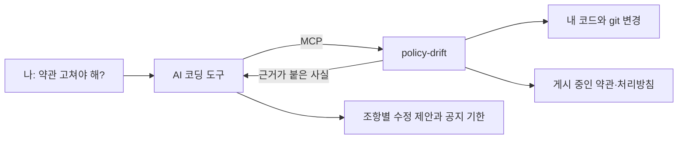

<div align="center">

# policy-drift

**코드는 바뀌었는데, 약관은 그대로인가요?**

배포 전에 AI 코딩 도구에게 물어보세요. policy-drift 가 코드에는 있는데<br>
이용약관·개인정보처리방침에는 없는 것을 찾고, AI 가 고칠 문구를 제안합니다.

**한국어** · [English](README.en.md)


[설치](#설치) · [이렇게 물어보세요](#ai-에게-이렇게-물어보세요) · [답변 예시](#답변-예시) · [설정](#설정) · [지원 범위](#지원-범위) · [한계](#한계)

</div>

---

```text
나     > 배포 전인데 약관 수정해야 하나?

AI     > 수정이 필요한 곳 1건 · 개인정보처리방침 1건

         1. 개인정보처리방침 4. 처리 위탁 — 표에 한 줄 추가
            이유: 활동 내용을 OpenAI 로 보내는 코드가 추가됨
            근거: services/api/src/ai/summarizer.ts:12
            제안 문구: | OpenAI, L.L.C. | 활동 내용 AI 분석 | 처리 목적 달성 시까지 |
            확신: 높음

         공지 기한: 처리방침 13항 기준 시행 7일 전
         ※ 초안입니다. 법률 자문이 아니며 게시 전에 담당자가 확인해야 합니다.
```

## 무엇이 다른가

| | |
|---|---|
| **조항 단위로 고칠 문구까지** | 어느 조항을 왜 어떤 문구로 고칠지, 내 문서의 개정 조항에 따라 며칠 전에 공지해야 하는지 알려 줍니다. 체크리스트로 끝나지 않습니다. |
| **모든 지적에 근거** | 항목마다 코드의 `파일:줄` 을 붙입니다. 맞는지 바로 열어 볼 수 있습니다. |
| **내 컴퓨터 안에서만** | 계정도 API 키도 필요 없고 사용 통계도 수집하지 않습니다. 코드는 컴퓨터 밖으로 나가지 않습니다. |
| **한국 약관에 맞춤** | `제N조` 형식의 약관과 개인정보 보호법의 필수 항목, 국외 이전 항목을 봅니다. 조문 근거는 law.go.kr 원문과 대조했습니다. GDPR 은 기본 목록만 지원합니다([지원 범위](#지원-범위)). |

## 왜 필요한가

기능은 1년 내내 나갑니다. 그 사이 코드는 사용자 입력을 LLM API 로 보내고, 오류 추적 도구를 붙이고, 푸시 알림 SDK 를 넣었습니다. 처리방침은 출시 때 모습 그대로입니다. 코드 리뷰에는 문서를 가리키는 항목이 없으니 아무도 고치자고 말하지 않습니다. policy-drift 는 코드와 문서를 둘 다 읽고 어디가 어긋났는지 알려 줍니다.

## 어떻게 동작하나



policy-drift 는 로컬 MCP 서버이자 CLI 입니다. 새로 생긴 외부 서비스, 개인정보 필드, 바뀐 규칙 숫자, 잘못된 조문 참조 같은 사실만 모으고 LLM 을 직접 부르지 않습니다. AI 코딩 도구가 그 사실과 문서를 읽고 어느 조항을 왜 어떤 문구로 고쳐야 하는지 답합니다.

## 지원 범위

한국 서비스를 먼저 지원합니다. 코드를 읽는 기능은 나라와 상관없이 동작하고 문서를 읽는 기능은 한국 약관 형식과 한국 법에 맞춰져 있습니다.

| 기능 | 한국 | 그 외 |
|---|---|---|
| 외부 서비스·추적 도구·개인정보 필드 탐지 | 지원 | 지원 |
| 변경 비교, 규칙 숫자 후보 | 지원 | 지원 |
| 처리방침에 서비스가 적혀 있는지 대조 | 지원 | 지원 |
| 필수 항목 검사 | 개인정보 보호법·시행령 11개 항목 | GDPR 제13조 12개 항목 (목록 수준) |
| 국외 이전 항목 검사 | 지원 | 없음 |
| 조문 참조 오류 검사 | 지원 (`제N조 제M항`) | 없음 |
| 조항 나누기 | `제N조`, 번호 제목 | 마크다운 제목만 |

미국(CCPA), 일본, 중국 규칙은 없습니다. 필요하면 이슈로 알려 주세요.

## 설치

Claude Code:

```bash
claude mcp add policy-drift -- npx -y policy-drift
```

Cursor 등 다른 MCP 클라이언트는 MCP 설정에 아래를 추가합니다.

```json
{
  "mcpServers": {
    "policy-drift": { "command": "npx", "args": ["-y", "policy-drift"] }
  }
}
```

그다음 문서를 게시하는 repo 폴더에서 실행합니다.

```bash
npx policy-drift init
```

`init` 은 예시 `.policy-drift.json` 을 만듭니다. 파일 안의 문서 경로를 실제 처리방침·약관 위치로 바꿉니다([설정](#설정) 참고). 설정 파일이 없어도 `scan_data_map` 과 `scan_changes` 는 현재 폴더에서 동작합니다. 문서가 필요한 도구는 `init` 을 먼저 실행하라고 답합니다.

## AI 에게 이렇게 물어보세요

- "배포 전인데 약관이나 처리방침 고쳐야 해?"
- "이 repo 로 정책 전체 점검을 돌려 줘."
- "이 코드가 사용자 데이터를 보내는 외부 서비스가 뭐야?"
- "main 이후로 바뀐 것 중에 처리방침에 영향 주는 게 있어?"

서버는 `pre-deploy-check` 와 `full-audit` 프롬프트도 등록합니다. 프롬프트를 보여 주지 않는 클라이언트에서도 같은 안내가 `scan_changes` 와 `audit` 결과 끝에 붙습니다.

## 답변 예시

호스트 AI 는 아래 형식으로 답합니다. 형식은 서버가 내려 주므로 어느 클라이언트에서든 같습니다.

```
수정이 필요한 곳 2건 · 이용약관 1건, 개인정보처리방침 1건

1. 개인정보처리방침 4. 처리 위탁 — 표에 한 줄 추가
   이유: 사용자 활동 내용을 OpenAI 로 보내는 코드가 추가됨
   근거: services/api/src/ai/summarizer.ts:12
   현재 문구: (해당 표)
   제안 문구: | OpenAI, L.L.C. | 활동 내용 요약 | 처리 목적 달성 시까지 |
   확신: 높음

2. 이용약관 제11조 2항 — 숫자 수정
   이유: 재결제 횟수 상수가 3 → 5 로 바뀜
   근거: src/billing/RetryPolicy.kt:18
   현재 문구: "총 3번의 재결제가 시도됩니다"
   제안 문구: "총 5번의 재결제가 시도됩니다"
   확신: 확인 필요 (회원에게 불리한 변경일 수 있음)

공지 기한: 약관 제3조 3항 기준 7일 전(불리한 변경이면 30일 전)
※ 초안입니다. 법률 자문이 아니며 게시 전에 담당자가 확인해야 합니다.
```

정해진 것은 이렇습니다. 항목마다 조항, 이유, 근거, 현재 문구, 제안 문구, 확신을 담습니다. 확신은 `높음` 과 `확인 필요` 두 가지뿐이고 "회원에게 불리한가" 같은 해석이 필요한 판단은 항상 `확인 필요` 입니다. 공지 기한은 문서 안의 개정 조항에서 먼저 읽고, 없을 때만 규칙 묶음의 기본값을 씁니다. 고칠 것이 없으면 없다는 한 줄로 끝납니다.

## MCP 도구

| 도구 | 돌려주는 것 |
|---|---|
| `scan_data_map` | 전체 코드의 외부 서비스(회사·국가·용도), 개인정보 필드, 기능 목록. 항목마다 근거 `파일:줄` |
| `scan_changes` | 기준 브랜치와 작업 폴더(커밋하지 않은 변경 포함)를 비교해 새로 생기거나 사라진 것, 규칙 숫자 후보, 비교하지 못한 root(`skipped`)와 비교의 제약(`notes`) |
| `get_policies` | 게시 중인 문서를 조항(id·제목·본문·줄)으로 쪼갠 것 |
| `get_checklist` | 관할별 필수 항목과 근거 조문, 공지 기본값, 답변 형식 |
| `audit` | [판정 방식](#판정-방식)에 적은 기계 대조 결과 |

## CLI

```bash
npx policy-drift                      # MCP 서버를 stdio 로 시작
npx policy-drift init                 # 예시 .policy-drift.json 생성 (덮어쓰지 않음)
npx policy-drift audit                # 대조 결과를 표로 출력. 발견이 있어도 종료 코드 0
npx policy-drift audit --diff [base]  # 기준 브랜치 이후의 변경을 비교
npx policy-drift audit --lang en      # 설정의 언어를 덮어씀 (ko 또는 en)
```

`audit --diff` 는 새로 생긴 서비스가 처리방침에 언급되지 않았으면 종료 코드 1 을 내므로 CI 에 붙일 수 있습니다. 오류(설정 없음, 없는 root, 대조할 처리방침 문서 없음)와 비교하지 못한 root(git repo 가 아님, 기준 브랜치 없음)가 있을 때는 종료 코드 2 이고, 건너뛴 root 와 이유를 먼저 출력합니다. 기준 브랜치가 지금 커밋과 같으면(`main` 에서 바로 작업하는 경우) 커밋하지 않은 변경만 보입니다. 이때는 출력의 참고 항목에 그렇게 적히니, 태그나 커밋을 `base` 로 넘기세요. 가져오지 못한 문서는 stderr 에 알리고 나머지 문서는 계속 처리합니다.

## 설정

`.policy-drift.json` 은 문서를 게시하는 repo 에 둡니다.

```json
{
  "language": "ko",
  "jurisdictions": ["kr", "gdpr"],
  "roots": [
    { "path": ".", "baseBranch": "main" },
    { "path": "../backend", "baseBranch": "main" }
  ],
  "policies": [
    { "type": "privacy", "source": "file", "path": "docs/privacy.md" },
    { "type": "terms", "source": "url", "url": "https://example.com/terms" },
    { "type": "terms", "source": "http-json", "format": "markdown",
      "url": "https://api.example.com/graphql",
      "headers": { "Authorization": "Bearer ${POLICY_DRIFT_TOKEN}" },
      "body": { "query": "query { latestTerms { body } }" },
      "pick": "data.latestTerms.body" }
  ]
}
```

| 필드 | 뜻 |
|---|---|
| `language` | `ko` 또는 `en`. 답변 형식과 CLI 출력 언어. 기본 `ko` |
| `jurisdictions` | 적용할 규칙 묶음: `kr`, `gdpr`. 기본 `["kr"]` |
| `roots[].path` | 훑을 폴더. 기본 `[{ "path": "." }]`. git repo 가 아닌 root 는 훑기만 하고 변경 비교에서는 건너뜀 |
| `roots[].baseBranch` | `scan_changes` 의 기준 브랜치. 없으면 `main`, `develop`, `master` 중 처음 있는 것(로컬, 그다음 `origin/`) |
| `policies[].type` | `privacy` 또는 `terms` |
| `policies[].source` | `file`(마크다운·MDX), `url`(HTML 에서 본문만 추림), `http-json`(POST 후 점 경로로 값 추출) |
| `headers` | `url`, `http-json` 용. `${NAME}` 은 환경 변수로 바꿔 넣되 이름이 `POLICY_DRIFT_` 로 시작하는 것만 허용. 다른 이름이거나 설정되지 않았으면 변수 이름을 말하는 오류. 비밀값을 파일에 적지 않음 |
| `pick` | JSON 응답 안의 점 경로. 숫자 조각은 배열 인덱스 |
| `format` | `http-json` 에서 뽑은 값이 `markdown` 인지 `html` 인지. 내용이 HTML 태그로 시작하면(`file` 은 `.html` 로 끝나도) 설정과 상관없이 HTML 로 읽음 |

`url`, `http-json` 은 `https://` 주소만 가져옵니다(로컬 확인용 `http://localhost`, `http://127.0.0.1` 은 허용). 응답은 15초까지 기다립니다.

셸 명령을 실행하는 출처는 없습니다. 남의 repo 를 열었을 때 설정 파일로 명령이 실행되지 않습니다.

## 무엇을 찾나

모든 탐지기는 결정적입니다. 같은 입력이면 같은 결과가 나옵니다. `node_modules`, `.git`, `dist`, `build`, `.next`, `.worktrees` 와 도구 폴더(`.claude`, `.cursor`, `.vscode`, `.idea`, `.github`), 1MB 가 넘는 파일, git 이 무시하는 파일은 읽지 않습니다. 의존성 파일을 뺀 나머지 탐지기는 테스트 코드(`*.test.*`, `*.spec.*`, `test/`, `tests/`, `__tests__/`, `__mocks__/`, `fixtures/`, `e2e/`, `*Test.kt`, `*Spec.groovy`, `*_test.go`, `test_*.py` 등)도 건너뜁니다.

| 탐지기 | 읽는 것 | 찾는 것 |
|---|---|---|
| 의존성 | `package.json`, `build.gradle(.kts)`, `requirements.txt`, `pyproject.toml` | 사전에 있는 패키지 → 회사·국가·용도 |
| 호스트 | 소스·설정의 URL 문자열 | 사전에 있는 도메인 (예: `api.openai.com`) |
| 추적 스크립트 | 프론트 소스 | `gtag(`, `fbq(`, `clarity(` 같은 호출 |
| 개인정보 필드 | SQL migration, Prisma 스키마, GraphQL 스키마, 폼 `name` 속성 | 영어·한국어 키워드 사전: email, phone, birth, address, 주민, 계좌, 카드 등 |
| 규칙 숫자 | 기준 브랜치와의 diff | 결제·환불·재시도·만료·탈퇴·포인트 키워드가 든 줄이나 경로에서 바뀐 숫자 상수. 영문 키워드는 식별자 단위로 찾아서 `endpoint` 는 `point` 가 아님. 매니페스트·lock 파일, 스타일 파일, class 문자열과 CSS 단위는 건너뜀 |
| 기능 목록 | 프론트 라우트 폴더, GraphQL 최상위 query·mutation 이름 | 이름 목록만. 해석하지 않음 |
| 조문 참조 | 문서 본문 | 없는 조·항을 가리키는 참조, 자기 자신을 가리키는 참조 |

## 판정 방식

오탐을 줄이려고 기계는 확실한 것만 단정합니다.

| 검사 | 판정 | 결과 표시 |
|---|---|---|
| 코드에 있는 서비스의 이름 중 하나라도 처리방침에 있음 | 언급됨 | 보고하지 않음 |
| 서비스 이름은 없고 모회사 이름만 있음 (Firebase 는 없고 Google 만 있음) | 불확실 | `확인 필요` |
| 이름도 모회사도 없음 | 언급 없음 | `언급 없음` |
| 필수 항목의 키워드가 문서 어디에도 없음 | 후보 | `항목 없음 (후보)` |
| 본사가 국외인 서비스가 코드에 있는데 국외 이전 키워드가 없음 (`kr` 묶음만) | 후보 | `항목 없음 (후보)` |
| 조문 참조가 없는 조·항을 가리킴 | 확정 | `참조 오류` |

영문 이름은 대소문자를 무시하고 단어 경계로 찾습니다. "Sentry" 는 "sentryx" 와 맞지 않습니다. 한글 등 그 밖의 문자로 된 이름은 부분 일치로 찾습니다. 평범한 영단어이기도 한 브랜드 이름(Resend, Meta, Segment, Clerk, Stripe)은 대소문자까지 같은 온전한 단어일 때만 언급으로 봅니다. "we resend the email" 은 Resend 언급이 아닙니다. 후보는 사람이나 호스트 AI 가 문서를 읽고 확정해야 하며 CLI 는 후보를 후보라고 표시한 채 보여 줍니다.

## 한계

- 정규식 기반입니다. AST 분석이 아니라서 변수로 조립한 URL 과 동적 import 는 놓칩니다.
- 규칙 숫자는 후보 목록입니다. 바뀐 숫자와 그 숫자가 적힌 약관 조항을 짝짓는 일은 호스트 AI 가 하며 정확도는 처리방침 검사보다 낮습니다.
- 필수 항목 검사는 키워드를 찾습니다. 흔치 않은 표현으로 쓴 항목은 있어도 후보로 보고됩니다.
- 법률 자문이 아닙니다. 결과는 담당자가 확인할 초안입니다.
- `rules/kr.yaml` 의 한국 법령 조문은 2026-11-12 에 법제처 Open API([law.go.kr](https://www.law.go.kr))의 현행 본문과 대조했습니다. 법은 바뀌므로 파일에 대조한 시행일을 적어 두었습니다. 개인정보보호위원회 작성지침 원문은 열어 보지 못해서, 규칙 묶음은 법과 시행령만 따릅니다.
- GDPR 묶음은 제13조 고지 항목 목록이 전부입니다.
- 조 제목은 줄이 `제N조` 로 시작하고 뒤에 `(…)`, `【…】`, `[…]` 가 오거나 아무것도 없을 때 알아봅니다(굵게 써도 됨). `제1장` 같은 장 구분과 다른 번호 체계는 나누지 않고, `제N조의M` 참조는 검사하지 않습니다.
- 웹 문서는 UTF-8 로만 읽습니다. EUC-KR 페이지는 글자가 깨집니다.
- 카카오 알림톡은 사전에 있어 문서에 적힌 이름은 알아보지만 코드에서는 찾지 못합니다. 대행사를 거쳐 보내서 전용 SDK 나 주소가 없기 때문입니다.

## 함께 쓰면 좋은 도구

policy-drift 는 법령을 조회하지 않습니다. 대신 답변 형식에서 AI 가 조문 번호를 기억으로 적지 못하게 합니다. 규칙 묶음에 있는 조문이거나 법령 조회 도구로 원문을 확인한 조문만 인용하고, 아니면 "근거 법령 확인 필요"라고 적습니다. 한국 법 조문까지 확인된 인용을 받고 싶다면 [korean-law-mcp](https://github.com/chrisryugj/korean-law-mcp) 같은 법령 MCP 서버를 함께 연결하세요. 법제처 Open API 인증키(open.law.go.kr)가 필요해서 선택 사항으로 두었고, 이 도구에 포함하지 않았습니다.

## 서비스 추가하기

`registry/vendors.yaml` 에 항목 하나를 추가합니다. `source` URL 이 없는 항목은 받지 않습니다.

```yaml
- id: example-analytics
  names: [Example Analytics, "Example Analytics, Inc.", 예제 애널리틱스]  # 문서에서 불릴 수 있는 모든 이름
  parent: example                  # 선택: 모회사 항목의 id
  country: US                      # 법인 본사의 ISO 3166 alpha-2
  purpose: Web analytics
  packages: [example-analytics, "@example/*"]   # 끝의 * 는 접두 일치
  domains: [collect.example-analytics.com]   # 호스트, 또는 호스트/경로 접두
  trackers: ["exampleAnalytics("]  # 선택: 브라우저 호출 패턴
  strictNames: [Example]           # 선택: 평범한 단어이기도 한 이름. 대소문자까지 같은 온전한 단어만 인정
  source: https://example-analytics.com/legal   # 국가나 법인을 확인한 공식 페이지
```

## 개인정보

모든 처리는 내 컴퓨터 안에서 끝납니다. 사용 통계를 수집하지 않습니다. 네트워크 요청은 설정에 적은 문서 주소로만, https 로만 나갑니다. 헤더에 넣는 환경 변수는 이름이 `POLICY_DRIFT_` 로 시작하는 것뿐이라, 남의 repo 를 열어도 그 설정 파일이 다른 비밀값을 어디로도 보낼 수 없습니다. 오류 메시지에는 헤더 값을 넣지 않습니다. 코드와 문서를 읽기만 하고 쓰지 않습니다. 프로젝트에 만드는 파일은 `init` 이 쓰는 `.policy-drift.json` 하나뿐이고 이미 있으면 쓰지 않습니다. `audit --diff` 와 `scan_changes` 는 기준 커밋의 파일을 임시 폴더에 풀어 비교한 뒤 지웁니다.

## 라이선스

MIT
